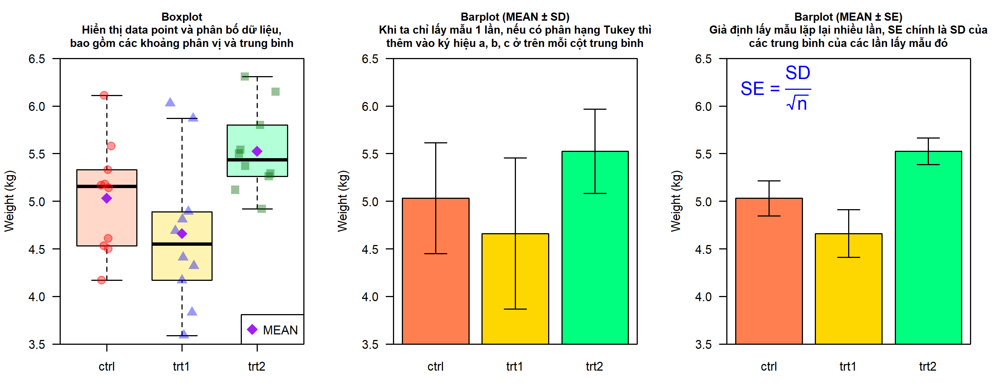

```{r, echo=FALSE, results='hide'}
knitr::opts_chunk$set(message = FALSE,  
                      warning = FALSE)   
```

# **Đồ thị boxlot và barplot** 

[**Tài liệu biên soạn trong chuyên đề R Statistics**](https://www.tuhocr.com/r-statistics)

## **Câu 1** {#cau-1}

Bạn có dữ liệu đo trọng lượng của cây trồng theo các nghiệm thức `ctrl`, `trt1` và `trt2`.

```{r}
PlantGrowth
```

**Bạn hãy vẽ hình như sau.**

[**Để phóng lớn hình ảnh, bạn right-click vào hình chọn *Open image in new tab*.**]{style="color:#006600"}



Bài tập này bao gồm các cơ chế:

* Cách vẽ nhiều đồ thị trên một khung hình (layout đồ thị)

* Cách chèn ký hiệu toán học trong Base R (`?plotmath`)

* Các lệnh tinh chỉnh đồ thị, scale limit và trích tọa độ vị trí các cột


::: {.callout-tip collapse="true" title="Đáp án"}

<style>
div.yes123 pre { background-color:#fff2cc; font-size: 16px; }
div.yes123 pre.r { background-color:#F1F3F5; font-size: 16px; }
</style>
<div class = "yes123">

**Subset kết quả trọng lượng theo từng nghiệm thức**

```{r}
ctrl <- PlantGrowth$weight[PlantGrowth$group == "ctrl"]

trt1 <- PlantGrowth$weight[PlantGrowth$group == "trt1"]

trt2 <- PlantGrowth$weight[PlantGrowth$group == "trt2"]
```

**Vẽ đồ thị**

```{r}
png(filename = "boxplot_barplot.png",
    width = 9,
    height = 3.5,
    units = "in",
    res = 300)

par(mfrow = c(1,3))
par(mar = c(3,4.1,4,2))

set.seed(3)

boxplot(ctrl, trt1, trt2,
        names = c("ctrl", "trt1", "trt2"),
        col = adjustcolor(c("coral",
                            "gold",
                            "springgreen"), 
                            alpha.f = 0.3),
        las = 1,
        ylab = "Weight (kg)",
        outline = F,
        notch = F,
        main = "Boxplot\nHiển thị data point và phân bố dữ liệu,\nbao gồm các khoảng phân vị và trung bình",
        ylim = c(3.5, 6.5),
        yaxs = "i",
        cex.main = 0.9)

points(x = jitter(rep(1, length(ctrl)),
                  factor = 5),
       y = ctrl,
       pch = 19,
       cex = 1.5,
       col = adjustcolor(col = "red", alpha.f = 0.4))

points(x = jitter(rep(2, length(trt1)),
                  factor = 5),
       y = trt1,
       pch = 17,
       cex = 1.5,
       col = adjustcolor(col = "blue", alpha.f = 0.4))

points(x = jitter(rep(3, length(trt2)),
                  factor = 5),
       y = trt2,
       pch = 15,
       cex = 1.5,
       col = adjustcolor(col = "darkgreen", alpha.f = 0.4))

###

points(x = 1,
       y = mean(ctrl),
       pch = 18,
       col = "purple",
       cex = 2)

points(x = 2,
       y = mean(trt1),
       pch = 18,
       col = "purple",
       cex = 2)

points(x = 3,
       y = mean(trt2),
       pch = 18,
       col = "purple",
       cex = 2)

legend(x = "bottomright",
       y = NULL,
       legend = c("MEAN"),
       col = "purple",
       pch = 18,
       pt.cex = 2
       )

#################
# THAM KHAO
# https://tuhocr.github.io/homework/template-do-thi-base-r-phan-1.html#barchart-mean-sd

aggregate(weight~group,
          data = PlantGrowth,
          FUN = mean) -> mean_tree


aggregate(weight~group,
          data = PlantGrowth,
          FUN = sd) -> sd_tree

df_tree <- cbind(mean_tree,
                 sd_tree[ , -1, drop = F])

names(df_tree)[c(2,3)] <- c("MEAN", "SD")

df_tree$count <- 10
df_tree$SE <- df_tree$SD / sqrt(df_tree$count)
 
a <- barplot(MEAN ~ group,
        data = df_tree,
        col = c("coral", "gold", "springgreen"),
        ylim = c(3.5, 6.5),
        xpd = F,
        xlab = "",
        yaxs = "i",
        las = 1,
        ylab = "Weight (kg)",
        main = "Barplot (MEAN \U00B1 SD)\nKhi ta chỉ lấy mẫu 1 lần, nếu có phân hạng Tukey thì\nthêm vào ký hiệu a, b, c ở trên mỗi cột trung bình",
        cex.main = 0.9)

box()

a

arrows(x0 = a,
       x1 = a,
       y0 = df_tree$MEAN - df_tree$SD,
       y1 = df_tree$MEAN + df_tree$SD,
       code = 3,
       angle = 90,
       length = 0.1,
       lwd = 1)

#######################

b <- barplot(MEAN ~ group,
        data = df_tree,
        col = c("coral", "gold", "springgreen"),
        ylim = c(3.5, 6.5),
        xpd = F,
        xlab = "",
        yaxs = "i",
        las = 1,
        ylab = "Weight (kg)",
        main = "Barplot (MEAN \U00B1 SE)\nGiả định lấy mẫu lặp lại nhiều lần, SE chính là SD của\ncác trung bình của các lần lấy mẫu đó",
        cex.main = 0.9)

box()

text(x = 0.8,
     y = 6.2,
     labels = expression("SE"~"="~frac(SD, sqrt(n))),
     xpd = T,
     col = "blue",
     cex = 1.5)

b

arrows(x0 = b,
       x1 = b,
       y0 = df_tree$MEAN - df_tree$SE,
       y1 = df_tree$MEAN + df_tree$SE,
       code = 3,
       angle = 90,
       length = 0.1,
       lwd = 1)


dev.off()
```


</div>

:::


